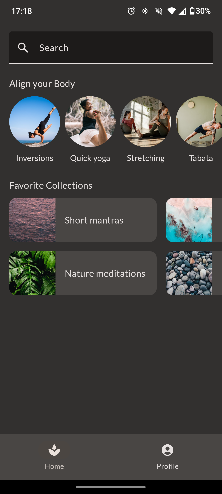
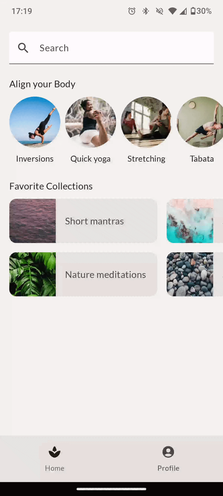

# Layouts Básicos no Jetpack Compose (App MySoothe)

Este repositório contém a implementação prática desenvolvida durante o codelab [**Basic Layouts in Compose (Layouts Básicos no Jetpack Compose)**](https://developer.android.com/codelabs/jetpack-compose-layouts?hl=pt-br#0), disponibilizado pelo Google.

O objetivo deste projeto é explorar como estruturar layouts reais e complexos de interface do usuário para Android (aplicativo de bem-estar *MySoothe*), utilizando composables fundamentais, alinhamentos, modificadores, ranhuras de conteúdo (*Slot APIs*) e contêineres de layout como o `Scaffold`.

## Tecnologias e Ferramentas Utilizadas

- **Linguagem:** Kotlin
- **UI Framework:** Jetpack Compose (Material Design 3)
- **Componentes Visuais:** `SearchBar`, `LazyRow`, `LazyColumn`, `Surface`, `Scaffold`, `NavigationBar`
- **IDE:** Android Studio
- **Mínimo SDK:** API level 24+

## Conceitos e Aprendizados Práticos

Durante a realização deste codelab, os seguintes tópicos foram estudados e implementados:

### 1. Elementos e Composables de Layout
- **Barra de Pesquisa:** Implementação de campo de busca estilizado com ícones e dicas visuais.
- **Grades e Listas Orientadas:** Construção de listas de rolagem horizontal (`LazyRow`) para coleções/categorias e itens circulares para coleções de alinhamento corporal.
- **Seções de Conteúdo Reutilizáveis:** Uso de *Slot APIs* para criar títulos de seção padronizados com suporte a conteúdos dinâmicos.

### 2. Estrutura de Tela com Scaffold
- Implementação do `Scaffold` para integrar a barra de navegação inferior (`NavigationBar` / `NavigationBarItem`) com o conteúdo principal da tela.

### 3. Layouts Adaptáveis (Suporte a Telas / Orientação)
- Organização modular da interface facilitando a adaptação para diferentes tamanhos de tela e orientação (retrato/paisagem).
- Aplicação de temas e tipografias personalizadas no Material Design 3.

## Evidências do Projeto (Demonstração Prática)

### 1. Interface Principal da Aplicação
Demonstração das seções de navegação, coleções e barras de busca estilizadas.

| Modo Claro | Modo Escuro |
| :---: | :---: |
|  |  |

### 2. Fluxo Interativo e Rolagem (GIF)
Demonstração da rolagem horizontal das coleções, rolagem vertical da tela principal e navegação inferior.

| Rolagem de Conteúdo e Interface |
| :---: |
|  |

## Como Executar o Projeto

1. Clone o repositório:
   ```bash
   git clone https://github.com/leticia-farias/layouts-basicos-compose.git
2. Abra o projeto no **Android Studio**.
3. Aguarde o término da sincronização do **Gradle**.
4. Execute o aplicativo em um emulador ou dispositivo físico (API 24+).
